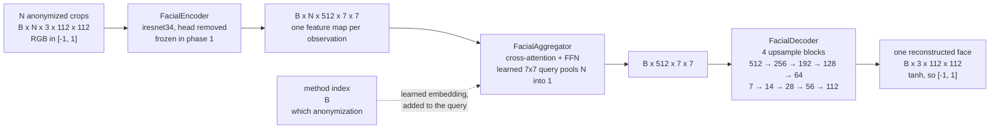
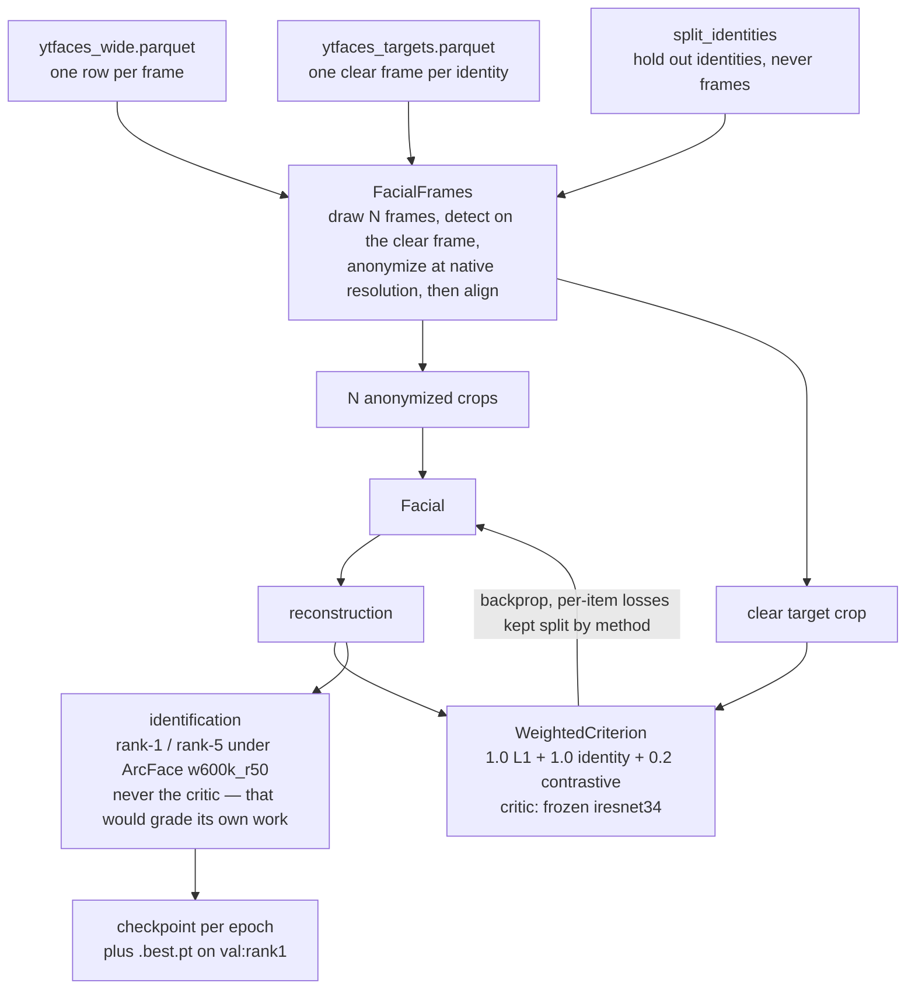
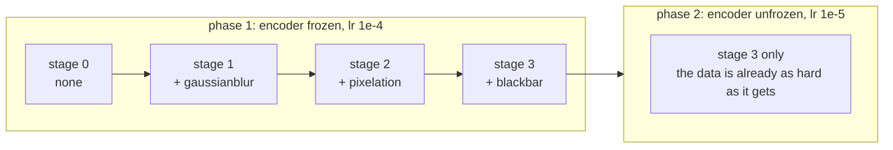

# Frame Aggregator: Facial

The goal is to train a model that can aggregate anonymized frames into a single clear frame that represents the identity.
The resulting frame should be optimized to be recognized by arcface (or create an embedding of its own).

| Stage              | Description                                                                                      | Shape                   |
|--------------------|--------------------------------------------------------------------------------------------------|-------------------------|
| Input              | `N = 8` anonymized aligned crops of one identity, unordered, plus which anonymization they carry | `B x N x 3 x 112 x 112` |
| Target             | One clear frame per identity, picked by `07_target_selection` from a video the inputs exclude    | `B x 3 x 112 x 112`     |
| Encode (per image) | `iresnet34` with ArcFace weights, head dropped for the 7x7 map. Frozen, then fine-tuned at 1e-5  | `B*N x 512 x 7 x 7`     |
| Aggregate          | One transformer block, cross-attention + FFN, learned 7x7 query conditioned on the anonymization | `B x 512 x 7 x 7`       |
| Decode             | Four upsample + conv blocks, GroupNorm/SiLU, 512 -> 256 -> 192 -> 128 -> 64, `tanh` output       | `B x 3 x 112 x 112`     |
| Output             | A single aligned facial image to identify the person                                             | `B x 3 x 112 x 112`     |
| Loss               | `1.0 * L1 + 1.0 * identity + 0.2 * contrastive`, the last two under a frozen `iresnet34` critic  | per item                |
| Score              | Rank-1/rank-5 under ArcFace `w600k_r50`, the recogniser the experiment itself scores with        | per method              |

The target is a **single chosen frame**, not a mean embedding. Identity is `1 - cos` and
contrastive is InfoNCE over the batch; LPIPS and a symmetry term are not implemented, and the
contrastive term took their place — rank-1 is a *ranking* question, and a reconstruction can grow
more similar to its target while growing just as similar to everyone.

## The model

`meles.frame_aggregation.facial.Facial`. One item is a whole identity: several anonymized
observations in, one clear face out. `N` is free — the aggregator attends over whatever it is
given — but a batch has to stack them, so the dataset fixes it (`FRAMES = 8`).

The encoder is shared across the `N` observations and the aggregator is permutation-invariant
except for the positional grid, so the frames are an unordered set, not a sequence.

## Training

`meles.training.facial`, driven by `src/notebooks/06_facial.ipynb`. One item per identity: the
observations come from the identity's *other* videos, the target is the one clear frame
`07_target_selection` picked, and both ends share one anonymization and one flip draw.

Two schedules run at once, and they are independent — `fit` is called **once per encoder phase**,
and walks the whole curriculum each time:

Each stage keeps everything before it and adds one method; a training item draws uniformly over
the unlocked prefix. The validation split is pinned to the **last** stage with `all_methods=True`
and `deterministic=True`, so every method is measured on the same identities and the same frames
from the first epoch onwards.

